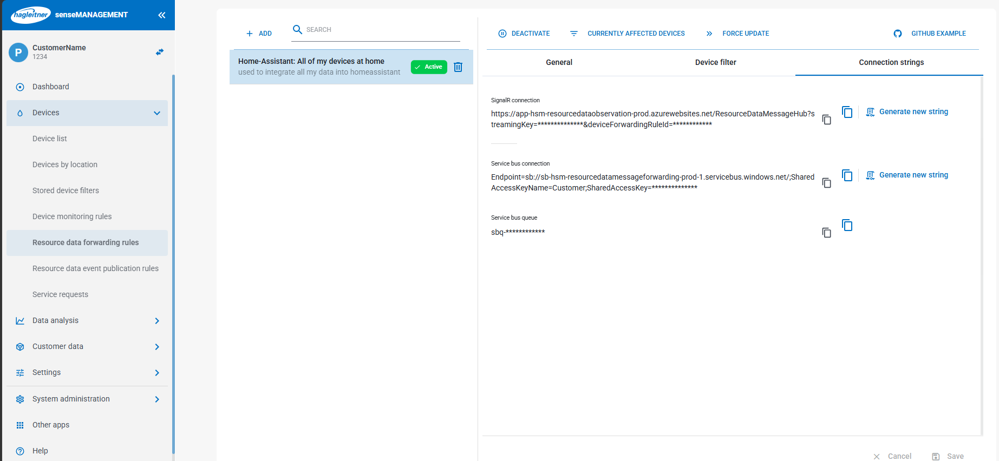

# Hagleitner Community

The **Hagleitner Community** integration connects Home Assistant to Hagleitner
device data forwarded from the [Hygiene Portal](https://hsm.hygieneportal.com/)
through Azure Service Bus. [Hagleitner](https://www.hagleitner.com/) develops
hygiene products and digital hygiene solutions. This is an independent
community project and is not maintained, supported, or endorsed by Hagleitner.

## Prerequisites

1. ResourceDataForwarding must be enabled for your customer. If the data-forwarding
   option or rule is unavailable, contact Hagleitner Sales to ask about enabling
   it. Confirm any applicable costs with Sales.
2. In the Hagleitner Hygiene Portal, visit
   [Devices → Data forwarding](https://hsm.hygieneportal.com/devices/data-forwarding)
   and create a **ResourceDataForwardingRule**. Select the devices whose values
   should be forwarded; **only selected devices are included**.
3. Open the rule's **Connection strings** tab and copy the **Service bus
   connection** and **Service bus queue** values. The SignalR connection is not
   used by this integration.



You can use multiple forwarding rules. Add each rule's queue as a separate
integration entry; devices included by more than one rule remain a single
Home Assistant device.

**Use only one active consumer for each queue.** If multiple Home Assistant
instances or integration entries consume the same queue, Service Bus distributes
messages between them, so each instance may miss some readings. If you run
multiple Home Assistant instances, create a separate forwarding rule (and queue)
for each instance.

## Install the integration

### Home Assistant 2026.11 or newer

The [Marketplace](https://www.home-assistant.io/integrations/marketplace/)
is built into Home Assistant. Open **Settings → Marketplace** and search for
**Hagleitner Community**. If it is not listed, use **Add from link** and enter
[`RePhilipp/hagleitner-community-integration`](https://github.com/RePhilipp/hagleitner-community-integration).
Open the repository and select **Install**. Follow any restart prompt shown by
Home Assistant.

### Home Assistant 2026.10 or older

These versions use HACS rather than the built-in Marketplace. Install HACS if
needed, then open **HACS → Integrations**. If Hagleitner Community is not listed,
add [`RePhilipp/hagleitner-community-integration`](https://github.com/RePhilipp/hagleitner-community-integration)
as a custom repository with the **Integration** category. Download the
integration and restart Home Assistant when prompted.

## Set up Home Assistant

1. Go to **Settings → Devices & services → Add integration** and choose
   **Hagleitner Community**.
2. Enter the Service Bus connection string and queue name from the portal.
3. When Home Assistant offers a newly detected device for adoption, confirm it
   to add the device. You can optionally assign it to a suggested area.

Entities appear as supported values arrive; there is no fixed list of entities
guaranteed for every device. Recognized connectivity issues, device errors, and
component replacement thresholds can also appear as maintenance tasks in Home
Assistant's Repairs page. Battery, refill, and fill levels remain available as
entities, not Repairs issues.

## Data updates

The integration receives pushed messages from Azure Service Bus; it does not
poll Hagleitner devices or request readings on a schedule. Supported entities
update when a forwarded resource-data message arrives. This integration does
not set or guarantee how often Hagleitner forwards readings, and this project
does not have a verified reporting interval or rate limit to publish. The
Service Bus receive wait is not a device reporting interval.

## Automation example

If a device provides supported refill or fill data, it can expose a **Refill
warning** binary sensor. Not every device provides these values. To show a Home
Assistant notification when a refill warning changes from off to on, replace
the example entity ID with that device's **Refill warning** entity ID:

```yaml
alias: Hagleitner refill reminder
triggers:
  - trigger: state
    entity_id: binary_sensor.replace_with_your_refill_warning_entity
    from: "off"
    to: "on"
actions:
  - action: persistent_notification.create
    data:
      title: Hagleitner refill warning
      message: A Hagleitner device reported a refill warning.
```

## Remove the integration

In **Settings → Devices & services**, delete the Hagleitner Community entries
you no longer need. Each queue is a separate entry, and adopted devices have
their own entries. Deleting a queue entry stops its Home Assistant receiver but
does not delete the Hagleitner forwarding rule or automatically delete adopted
device entries. Delete adopted device entries separately to unload their
entities and clear their maintenance issues.

Deleting an entry in Home Assistant does not change the forwarding rule in the
Hagleitner Hygiene Portal. To stop forwarding a device's data, edit the rule at
[Devices → Data forwarding](https://hsm.hygieneportal.com/devices/data-forwarding)
in the portal as well.

On Home Assistant 2026.11 or newer, remove the integration entries before
uninstalling the repository from the Marketplace. On older versions, remove the
entries before uninstalling it from HACS.

## Developer information

### Run tests locally

Tests target stable Home Assistant 2026.10.4 and require Python 3.14.2 or newer.
The matching test package is a regular release, although the project is marked
Alpha on PyPI. Tests run Home Assistant in-process; they do not start a server
or require Docker. The separate `.venv-ha` environment avoids changing an
existing integration or Python 3.12 environment. From the repository root:

```bash
python3.14 -m venv .venv-ha
source .venv-ha/bin/activate
python -m pip install --upgrade pip
python -m pip install -r requirements.txt -r requirements_test.txt
python -m pytest -q
```

Test dependencies are separate from the integration's runtime requirements.

### Try the integration in a local Home Assistant container

This isolated test instance uses Home Assistant 2026.10.4 and mounts the
integration from this checkout. Its configuration, including any credentials
entered in the UI, stays under the ignored `ha-test/` directory. From the
repository root:

```bash
mkdir -p ha-test/config
docker run -d \
  --name hagleitner-ha-test \
  -p 8124:8123 \
  -e TZ=Etc/UTC \
  -v "$PWD/ha-test/config:/config" \
  -v "$PWD/custom_components/hagleitner_community:/config/custom_components/hagleitner_community:ro" \
  ghcr.io/home-assistant/home-assistant:2026.10.4
docker logs -f hagleitner-ha-test
```

Open [http://localhost:8124](http://localhost:8124) to finish Home Assistant
onboarding and add the integration. A live queue connection is needed to
trigger device discovery. Stop and restart the container with
`docker stop hagleitner-ha-test` and `docker start hagleitner-ha-test`; the test
configuration is preserved between runs.

### Local receiver/debug

For troubleshooting from a local checkout, set `HAGLEITNER_SERVICE_BUS_CONNECTION_STRING`
and `HAGLEITNER_QUEUE_NAME` in your environment, then run
`python -m custom_components.hagleitner_community.debug_receiver`. Do not share
the connection string or commit it to files.
